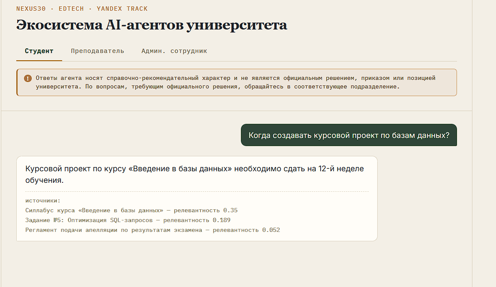
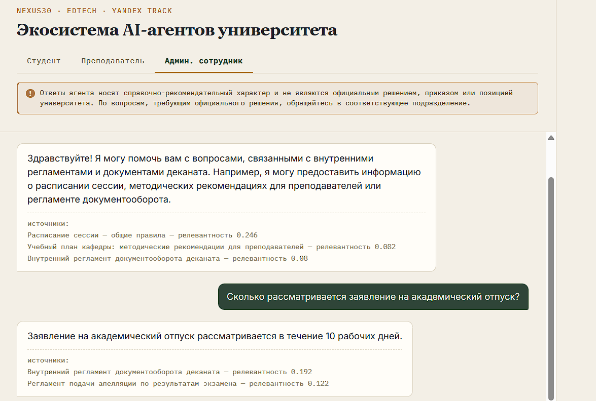

<div align="center">

# Navi

**AI-навигатор по университету**

Экосистема ролевых AI-агентов для студентов, преподавателей и администрации

[**Открыть демо**](https://navi-frontend-5474.onrender.com) · [API](https://navi-backend-2x2q.onrender.com/docs)

`NEXUS30` · трек EdTech · кейс Yandex

</div>

---

## Проблема

В вузах Узбекистана учится **1,54 млн студентов**, работает **215 вузов и филиалов**. Каждый день студенты, преподаватели и сотрудники ищут одно и то же: когда дедлайн, как подать заявление, что написано в регламенте.

Информация не потеряна — она есть. Но чтобы её найти, нужно знать, в каком документе искать, и прочитать его целиком.

При этом у трёх ролей три разных вопроса к одной базе — и, что важнее, **три разных права доступа**. Студенту незачем видеть внутренний документооборот деканата.

## Решение

Navi — одна платформа с тремя ролевыми агентами поверх общей базы документов вуза.

| | |
|---|---|
| **Ролевой агент** | Свой сценарий, тон и набор функций для каждой роли |
| **Поиск по документам** | Семантический поиск с показом источников и релевантности |
| **Суммаризация** | Сжатие длинных регламентов и заданий до сути |
| **Контекстный ответ** | Ответ строится на найденных документах, а не на догадках модели |



## Чем отличается

Разграничение доступа происходит **на этапе поиска, а не в тексте промпта**.

У каждой роли — отдельный поисковый индекс. Документа, который роли не положен, физически нет в её выдаче: модель не может «проговориться» о том, чего никогда не получала на вход. Это не запрет вида «не отвечай студенту про X», который обходится хитрой формулировкой.

**Один и тот же вопрос — два разных результата:**

> «Сколько рассматривается заявление на академический отпуск?»

| Роль | Результат |
|---|---|
| **Администратор** | «10 рабочих дней» — источник: внутренний регламент документооборота деканата |
| **Студент** | Регламент не найден, агент направляет в подразделение — документа нет в индексе роли |



## Как устроен ответ

```
Запрос + роль
      ↓
Ролевой поиск  ──  поиск ТОЛЬКО по документам, доступным этой роли
      ↓
Сборка контекста  ──  системный промпт роли + найденные фрагменты
      ↓
YandexGPT  ──  генерация ответа строго по контексту
      ↓
Ответ + источники  ──  видно, откуда взят каждый факт
```

## Стек

| Слой | Технология | Почему |
|---|---|---|
| Модель | **YandexGPT** (`yandexgpt-lite`) | Технология партнёра кейса, ответ за 1–2 секунды |
| Поиск | TF-IDF, отдельный индекс на роль | Основа разграничения доступа |
| Бэкенд | FastAPI | Асинхронный API, автодокументация, строгая валидация ролей |
| Фронтенд | React + Vite | Вкладки ролей, история диалога, отображение источников |
| Хостинг | Render (Blueprint) | Backend + frontend поднимаются одним деплоем |

Провайдер модели абстрагирован (`app/llm_client.py`): переключается одной строкой `LLM_PROVIDER` в `.env` между `yandex`, `anthropic`, `gemini`, `groq` — без правок кода.

## Соответствие требованиям кейса

| № | Требование | Реализация |
|---|---|---|
| 1 | AI-агент по роли | Три роли: свой промпт **и свой набор документов** |
| 2 | Суммаризация | `POST /summarize` + загрузка файла в интерфейсе |
| 3 | Поиск информации | RAG-поиск с отображением источников и релевантности |
| 4 | Контекстный ответ | Роль + найденный контекст передаются в модель |
| 5 | Удобный интерфейс | Веб-интерфейс с вкладками ролей, адаптивен под мобильные |
| 9 | Конфиденциальность и права доступа | Изоляция индексов по ролям + дисклеймер в интерфейсе |

## Запуск локально

**Бэкенд:**
```bash
cd backend
python3 -m venv venv && source venv/bin/activate
pip install -r requirements.txt
cp .env.example .env     # впишите ключи, см. ниже
uvicorn app.main:app --reload --port 8000
```

`.env` для YandexGPT:
```
LLM_PROVIDER=yandex
MODEL_NAME=yandexgpt-lite/latest
YANDEX_API_KEY=<ваш ключ>
YANDEX_FOLDER_ID=<ваш folder id>
```

**Фронтенд:**
```bash
cd frontend
npm install
cp .env.example .env
npm run dev
```

Откройте `http://localhost:5173`.

> Без сборки: `frontend/standalone.html` — тот же интерфейс одним файлом, React с CDN, открывается двойным кликом.

### Ключи Yandex Cloud

1. Консоль каталога → **Сервисные аккаунты** → создать
2. Назначить роль **`ai.languageModels.user`**
3. **Создать новый ключ** → **API-ключ**, область `yc.ai.languageModels.execute`
4. `YANDEX_FOLDER_ID` виден в адресной строке консоли

## Деплой

В корне лежит `render.yaml` — Render Blueprint поднимает оба сервиса:

1. Render → **New → Blueprint** → выбрать репозиторий → **Apply**
2. `navi-backend` → **Environment** → вписать `YANDEX_API_KEY`, `YANDEX_FOLDER_ID`
3. Скопировать URL бэкенда → `navi-frontend` → **Environment** → `VITE_API_BASE`
4. `navi-frontend` → **Manual Deploy** (Vite встраивает переменную при сборке)

## Структура

```
navi/
├── render.yaml                 # Blueprint: backend + frontend одним деплоем
├── backend/
│   ├── Procfile
│   └── app/
│       ├── main.py             # FastAPI: /chat, /summarize, /health
│       ├── agents.py           # системные промпты трёх ролей
│       ├── llm_client.py       # абстракция над провайдером модели
│       ├── rag.py              # ролевой TF-IDF поиск
│       └── data/documents.py   # демо-корпус документов
└── frontend/
    ├── src/App.jsx             # интерфейс, вкладки ролей
    ├── src/api.js              # клиент к backend
    └── standalone.html         # версия без сборки
```

## Дорожная карта

- **Сейчас** — работающий прототип на демонстрационном корпусе документов
- **Неделя** — подключение библиотеки документов вуза с периодической переиндексацией; интеграция с SSO университета: роль приходит из подписанного токена, а не выбирается пользователем
- **Месяц** — интеграция с LMS и системой документооборота, аналитика частых вопросов для деканата
- **Далее** — переход на векторную БД (Qdrant) для корпусов в десятки тысяч документов

## Ограничения прототипа

Честно о том, что ещё не сделано:

- Роль выбирается вручную и не аутентифицирована — в продакшене она должна приходить из SSO вуза, иначе разграничение доступа обходится выбором вкладки
- Корпус документов демонстрационный и задан в коде; загрузка документов вуза — следующий шаг
- Нет ограничения частоты запросов к API

---

<div align="center">

Команда **Navi** · NEXUS30 · 2026

</div>
