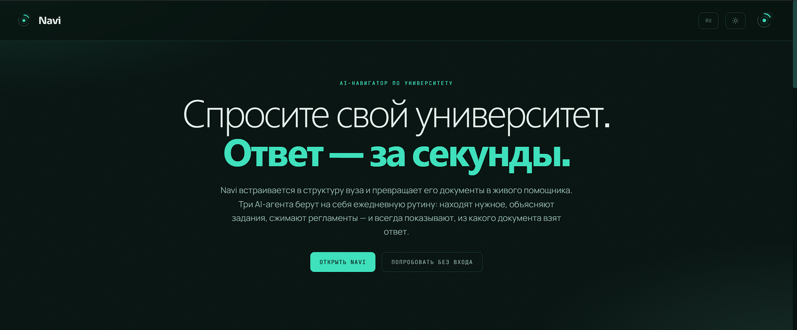
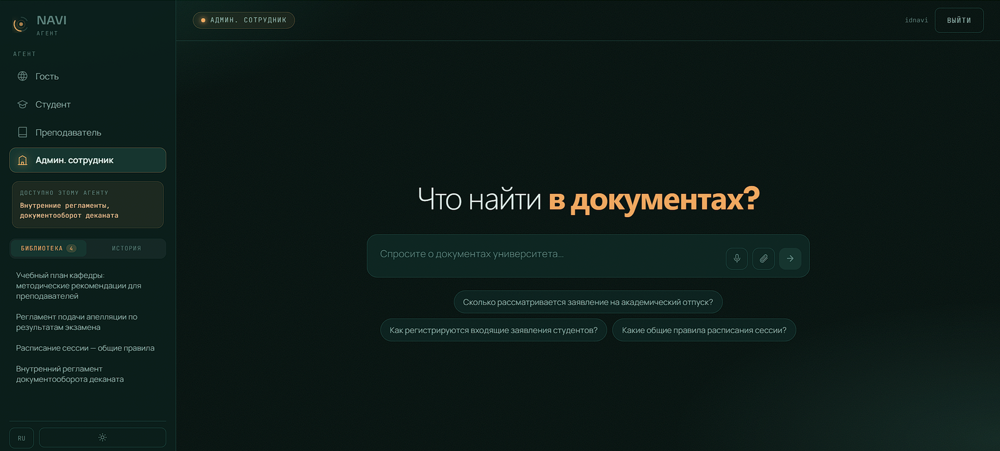

<div align="center">

# Navi

**An AI navigator for universities**

[Open the demo](https://navi-frontend-5474.onrender.com) · [API](https://navi-backend-2x2q.onrender.com/docs)

English · [Русский](README.ru.md)

</div>



## Why this exists

Ask any chatbot when to hand in a term paper at your university. It can't answer: those documents are not in any trained model. They live in the university's internal systems.

The obvious fix is to load the university's documents into an AI. But then the first student asks about the dean's office internal paperwork and gets an answer. General-purpose assistants have no concept of "this user must not see this."

Universities end up between two walls. The model that could help has no data. And the data can't be handed to the model wholesale, because students, teachers and administrators have different access rights.

Navi is the layer between them.

## How it works

Each agent has its own search index. The student agent has no access to the dean's office regulations, not because it was told not to answer, but because those documents are not in its index. A model cannot reveal what it never received as input, so attacking the prompt is pointless.

```
Query + role
     ↓
Search only within this agent's documents
     ↓
Role system prompt + retrieved passages
     ↓
YandexGPT
     ↓
Answer + the sources it was built from
```

In addition, the server checks permissions when a specific document is requested: a foreign document ID returns a denial, not the content.

## Features

| | |
|---|---|
| Three role-based agents | Student, teacher, administrative staff. Each has its own set of documents and its own scenario |
| Guest mode | General study questions without signing in. Guests cannot see internal documents |
| Search with sources | Under each answer you can see which document a fact came from and expand the exact passage |
| Summarization | A summary of an internal university document or an uploaded file |
| Role library | A list of the documents available to the agent, with a one-click summary |
| Material upload | A file goes into the library, takes part in search, and survives a server restart |
| Voice | Ask by voice and hear the answer read aloud via ElevenLabs |
| Three languages | Russian, English, Uzbek: both the interface and the model's answers |
| Requests | A question outside the agent's competence is sent to the dean's office via n8n |



## Stack

Backend on FastAPI, generation via YandexGPT, TF-IDF search with a separate index per role. Frontend in React and Vite, with no external UI libraries. Deployed on Render with a single Blueprint file.

The model provider is abstracted in `app/llm_client.py`: switch between `yandex`, `anthropic`, `gemini` and `groq` with one line in `.env`, without changing code.

## Running locally

**Backend**

```bash
cd backend
python3 -m venv venv && source venv/bin/activate
pip install -r requirements.txt
cp .env.example .env
uvicorn app.main:app --reload --port 8000
```

Minimal `.env`:

```
LLM_PROVIDER=yandex
MODEL_NAME=yandexgpt-lite/latest
YANDEX_API_KEY=<service account key>
YANDEX_FOLDER_ID=<folder ID>
```

Voice and automations are optional:

```
ELEVENLABS_API_KEY=<key>
ELEVEN_VOICE_ID=<voice ID>
N8N_WEBHOOK_URL=<webhook URL>
```

Without them the system still works; the corresponding buttons just report that the feature is unavailable.

**Frontend**

```bash
cd frontend
npm install
cp .env.example .env
npm run dev
```

Open `http://localhost:5173`. Demo login: `idnavi` / `demo`.

## Yandex Cloud keys

1. Folder console → **Service accounts** → create one
2. Assign the `ai.languageModels.user` role. Without it the API returns 403
3. In the account → **Create new key** → **API key**, scope `yc.ai.languageModels.execute`
4. The secret is shown only once, so copy it right away
5. `YANDEX_FOLDER_ID` is visible in the console address bar

## Deployment

The repository root contains `render.yaml`, which brings up both services.

1. Render → **New → Blueprint** → choose the repository → **Apply**
2. `navi-backend` → **Environment** → enter the Yandex keys
3. Copy the backend URL → `navi-frontend` → **Environment** → `VITE_API_BASE`
4. `navi-frontend` → **Manual Deploy**

The fourth step is required: Vite substitutes variables at build time, so changing the value in the dashboard is not enough.

## API

| Method | Path | Purpose |
|---|---|---|
| `POST` | `/chat` | Ask an agent a question, get an answer with sources |
| `POST` | `/summarize` | Summary of arbitrary text |
| `GET` | `/documents` | Documents available to the role |
| `POST` | `/summarize_document` | Summary of an internal document |
| `POST` | `/documents/upload` | Add a document to the library |
| `POST` | `/tts` · `/stt` | Text-to-speech and speech recognition |
| `GET` | `/voices` | Available voices |
| `POST` | `/ticket` | Request to the dean's office via n8n |
| `GET` | `/health` | Health check |

Interactive documentation is at `/docs` on a running backend.

## Automations

The `n8n` folder contains ready-made workflows and setup instructions: role-based request routing, a daily sync of the university's document library, and a morning digest for each role.

Events are sent without waiting for a response, so an unavailable n8n has no effect on the system.

## Pre-deploy check

```bash
cd frontend
npx esbuild render_test.mjs --bundle --platform=node --format=cjs --outfile=rt.cjs \
  --loader:.jsx=jsx --jsx=automatic --define:import.meta.env='{"VITE_API_BASE":"http://x"}'
node rt.cjs
```

The script renders the landing page and the app in three languages and two themes. It catches cases where an incomplete translation crashes the page, which has happened before.

## Structure

```
navi/
├── render.yaml              Blueprint: both services in one deploy
├── backend/
│   └── app/
│       ├── main.py          endpoints, permission checks, voice, webhooks
│       ├── agents.py        system prompts for the four modes
│       ├── llm_client.py    abstraction over the model provider
│       ├── rag.py           role-based search and reindexing
│       └── data/documents.py  demo corpus and uploaded documents
├── frontend/src/
│   ├── Landing.jsx          landing page
│   ├── Chat.jsx             the app
│   ├── Brand.jsx            logo and icons
│   ├── i18n.js              three languages
│   └── index.css            design system
└── n8n/                     automation workflows
```

## What's next

Next up is integration with the university's SSO so that the role comes from a signed token, and connecting a real university document library with scheduled reindexing.

After that: vector search instead of TF-IDF for corpora of tens of thousands of documents, integration with LMS and document management systems, and analytics on frequent questions for the dean's office.

The system is portable to any university without code changes: only the set of documents changes.

## Prototype limitations

The role is chosen after a shared sign-in rather than coming from the university's authentication system. In production this must be SSO.

Uploaded documents are visible to all users of their role and are kept in server memory, duplicated in the uploader's browser. Persistent storage is the next step.

There is no rate limiting on the API.

---

<div align="center">

**Navi** team · 2026

</div>
